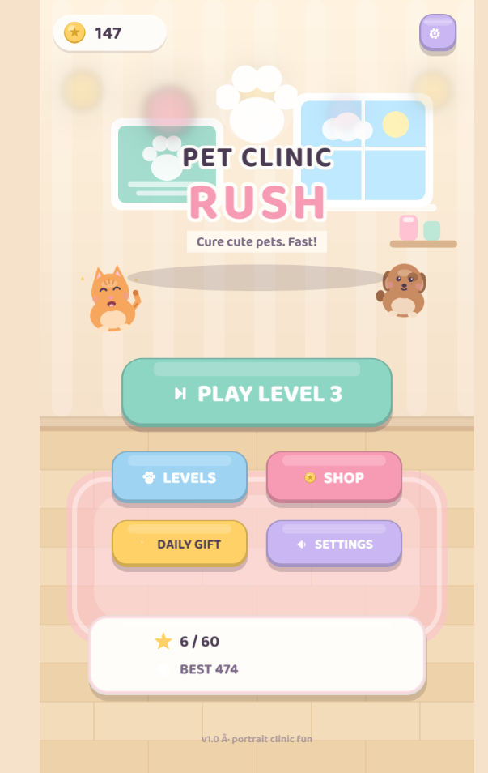

# Pet Clinic Rush

A cute, fast, one-thumb pet hospital game. Customers arrive with sick pets, you pop each one onto a bed and fix whatever is wrong — fever, wounds, mud, hunger, itches, sadness, sleepiness — before their patience runs out.

Built with Phaser 3, TypeScript and Vite. Playable in any modern browser, and packaged for Android with Capacitor.

[**▶ Play in your browser**](https://aamirali65.github.io/pet-clinic-rush/)

[](https://github.com/aamirali65/pet-clinic-rush/actions/workflows/deploy-pages.yml)



## Gameplay

1. A customer walks in carrying a pet. Tap the customer to pick the pet up.
2. Drag it onto a free bed (or tap the pet, then a bed).
3. Tap the occupied bed to open the tool tray. The thought bubble shows what the pet needs.
4. Treat each need with a one-finger action — tap, drag, hold, scrub or swipe.
5. Cure every need and the owner pays coins and score. A timed-out customer leaves angry and costs you a heart.

Chain cures without an angry customer to build a combo up to ×5.

### Treatments

| Need | Action |
| --- | --- |
| Fever | Drag the thermometer on, hold, then tap medicine |
| Wound | Tap the bandage onto the wound |
| Dirty | Scrub with the sponge until the ring fills, then rinse |
| Hungry | Drag the food bowl to the pet's mouth |
| Itchy | Swipe the brush across the pet |
| Sad | Tap the heart to fill the happiness meter |
| Sleepy | Tap the pillow and wait for the nap timer |

## Features

- **20 levels** with goals, time limits, tuning per level, and 1–3 star ratings.
- **6 pets** — cat, dog, rabbit, hamster, bird and turtle — each with their own needs and moods.
- **Shop with 19 upgrades**: extra beds and waiting chairs, more patient customers, faster tools, bigger coin payouts.
- **7-day daily gift** streak, tutorial, pause menu and settings.
- **Saved progress** (coins, stars, best scores, unlocks, settings) with a versioned, migrating save format.
- **Juice**: confetti, coin fly-to-HUD, popups, synthesized sound effects and haptic feedback on supported devices.
- Portrait-first 720×1280 layout that scales to any screen, with safe-area handling for notched phones.

## Tech stack

| Layer | Choice |
| --- | --- |
| Engine | [Phaser 3](https://phaser.io/) — WebGL with Canvas fallback |
| Language | TypeScript (strict) |
| Build | [Vite 8](https://vite.dev/) |
| Tests | [Vitest](https://vitest.dev/) |
| Lint / format | ESLint 10 + Prettier |
| Mobile | [Capacitor 8](https://capacitorjs.com/) (Android, haptics, preferences, status bar, splash screen) |
| CI / hosting | GitHub Actions → GitHub Pages |

Gameplay and UI communicate only through typed events (`src/contracts/events.ts`), and all game content lives in `src/config/`, so levels, pets and upgrades can be retuned without touching scene code.

## Getting started

Requires **Node.js 20.19+** (22 LTS recommended) and npm.

```bash
npm install
npm run dev        # http://127.0.0.1:5173
```

| Script | What it does |
| --- | --- |
| `npm run dev` | Start the Vite dev server with hot reload |
| `npm run build` | Typecheck, then build a production bundle to `dist/` |
| `npm run preview` | Serve the production build locally |
| `npm run typecheck` | `tsc --noEmit` |
| `npm run lint` | ESLint over the project |
| `npm test` | Run the Vitest suite (systems, config and save logic) |
| `npm run cap:sync` | Build and copy the web bundle into the Android project |
| `npm run android:run` | Sync, then build a debug APK with Gradle |

## Project structure

```
src/
  config/      levels, pets, needs, upgrades, customers, tunables
  contracts/   shared types, events and asset keys
  scenes/      boot, preload, menu, level select, game, HUD, result, shop, settings…
  objects/     pets, customers, beds, patience bars, particles
  systems/     scoring, spawning, level timer, star calculation
  ui/          buttons, panels, modals, tool tray, treatment overlay
  services/    audio, haptics, save/persistence
  utils/       generated placeholder art/textures
public/assets/ font, UI icons, pet art, particles, sound effects
android/       Capacitor Android project
```

## Deployment

Every push to `main` triggers [`.github/workflows/deploy-pages.yml`](.github/workflows/deploy-pages.yml), which builds the app and publishes `dist/` to GitHub Pages:

**https://aamirali65.github.io/pet-clinic-rush/**

The build uses a relative `base`, so it works from a project subpath without extra configuration.

## Android

The web build is wrapped with Capacitor (app id `com.petclinicrush.game`):

```bash
npm run cap:sync      # build + copy into android/
npm run android:run   # assemble a debug APK
```

Open the project in Android Studio with `npm run android:open` to run it on a device or emulator. Portrait orientation, status bar and splash screen are configured in `capacitor.config.ts`.

## Assets and credits

All art, audio and fonts are free-licensed or generated in code:

- **Baloo 2** font — Ek Type / Google Fonts, SIL Open Font License 1.1
- **Kenney** Game Icons, Interface Sounds, Particle Pack and Animal Pack Remastered — CC0

Placeholder textures are generated at runtime, so the game stays playable even if an asset is missing. Full file-by-file attribution lives in [ASSETS.md](ASSETS.md) and [CREDITS.md](CREDITS.md).

## License

No license has been chosen for this repository yet, so all rights are reserved. The bundled third-party assets keep their own licenses (OFL 1.1 and CC0), noted in [CREDITS.md](CREDITS.md).
